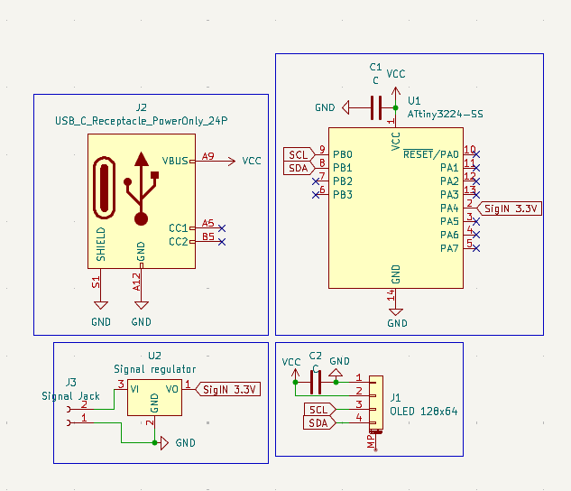
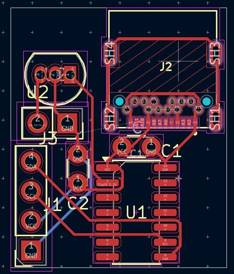
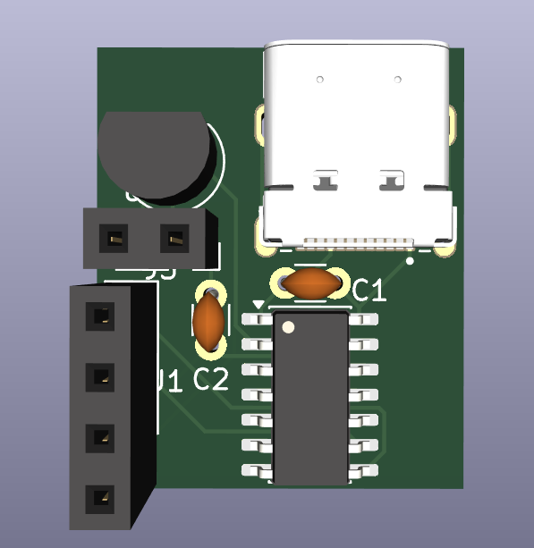

## Mini Oscilloscope
# Description
This is a mini version of an oscilloscope.
It is used to display some incoming readings on an analog pin and showing the results using an oled display as a wave like format.

# How does it work
What you do is connecting the 5V signal cable you want to read to the incoming connection on the board, it is then sent through a voltage regulator, lowering it to a safe 3.3V signal.
The aTTiny3224 then reads that signal on one of it's analog pins, calculate the correct pixel on the display and then store the result as an integer (whole number) using an 8BIT value.

The stored values are then using a specified "screen update frequency" displayed.
This is to allow the incoming signals to be read faster than the screen might be capable of.

# Schematic

# PCB

# Rendered

